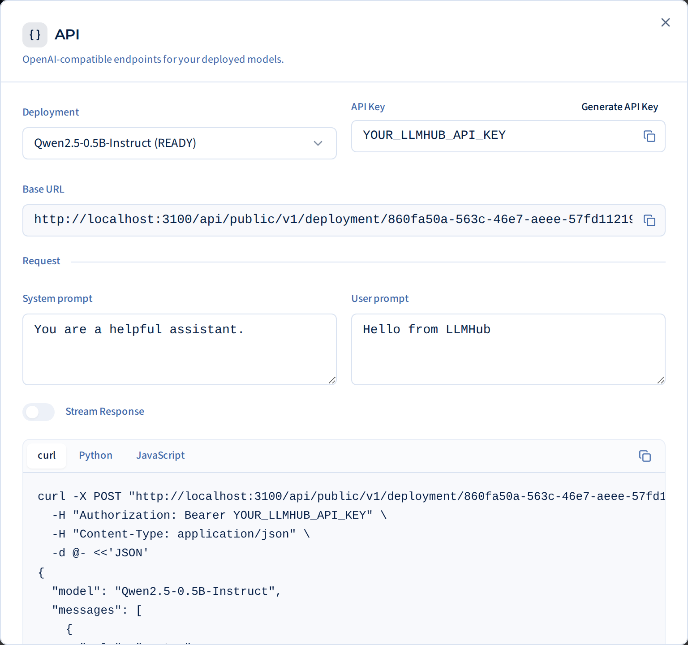

# Chat completions

```text
POST /api/public/v1/deployment/{deploymentId}/chat/completions
```

An OpenAI-compatible chat completions endpoint. LLMHub checks your key and
access, then passes the request unchanged to the deployment's
[vLLM](https://docs.vllm.ai) server, so anything vLLM's
`/v1/chat/completions` accepts works here.

The examples use placeholders. Replace them with the values from the
deployment's **API** dialog:

- `https://your-llmhub-host`: the LLMHub address
- `YOUR_DEPLOYMENT_ID`: the deployment's ID, which is part of the base URL
- `Qwen2.5-7B-Instruct`: the deployment's model name
- `YOUR_LLMHUB_API_KEY`: your API key (see [Authentication](authentication.md))

## Request

=== "curl"

    ```bash
    curl -X POST "https://your-llmhub-host/api/public/v1/deployment/YOUR_DEPLOYMENT_ID/chat/completions" \
      -H "Authorization: Bearer YOUR_LLMHUB_API_KEY" \
      -H "Content-Type: application/json" \
      -d '{
        "model": "Qwen2.5-7B-Instruct",
        "messages": [
          {"role": "system", "content": "You are a helpful assistant."},
          {"role": "user", "content": "Hello from LLMHub"}
        ]
      }'
    ```

=== "Python (OpenAI SDK)"

    ```python
    from openai import OpenAI

    client = OpenAI(
        base_url="https://your-llmhub-host/api/public/v1/deployment/YOUR_DEPLOYMENT_ID",
        api_key="YOUR_LLMHUB_API_KEY",
    )

    response = client.chat.completions.create(
        model="Qwen2.5-7B-Instruct",
        messages=[
            {"role": "system", "content": "You are a helpful assistant."},
            {"role": "user", "content": "Hello from LLMHub"},
        ],
    )

    print(response.choices[0].message.content)
    ```

=== "JavaScript (OpenAI SDK)"

    ```javascript
    import OpenAI from "openai";

    const client = new OpenAI({
      baseURL:
        "https://your-llmhub-host/api/public/v1/deployment/YOUR_DEPLOYMENT_ID",
      apiKey: "YOUR_LLMHUB_API_KEY",
    });

    const response = await client.chat.completions.create({
      model: "Qwen2.5-7B-Instruct",
      messages: [
        { role: "system", content: "You are a helpful assistant." },
        { role: "user", content: "Hello from LLMHub" },
      ],
    });

    console.log(response.choices[0].message.content);
    ```

## Response

A standard OpenAI chat completion:

```json
{
  "id": "chatcmpl-...",
  "object": "chat.completion",
  "created": 1760000000,
  "model": "Qwen2.5-7B-Instruct",
  "choices": [
    {
      "index": 0,
      "message": {
        "role": "assistant",
        "content": "Hello! How can I help you today?"
      },
      "finish_reason": "stop"
    }
  ],
  "usage": {
    "prompt_tokens": 25,
    "completion_tokens": 10,
    "total_tokens": 35
  }
}
```

## Streaming

Set `"stream": true` to receive server-sent events (SSE) as the model
generates:

=== "curl"

    ```bash
    curl -N -X POST "https://your-llmhub-host/api/public/v1/deployment/YOUR_DEPLOYMENT_ID/chat/completions" \
      -H "Authorization: Bearer YOUR_LLMHUB_API_KEY" \
      -H "Content-Type: application/json" \
      -d '{
        "model": "Qwen2.5-7B-Instruct",
        "messages": [{"role": "user", "content": "Hello from LLMHub"}],
        "stream": true
      }'
    ```

=== "Python (OpenAI SDK)"

    ```python
    stream = client.chat.completions.create(
        model="Qwen2.5-7B-Instruct",
        messages=[{"role": "user", "content": "Hello from LLMHub"}],
        stream=True,
    )

    for chunk in stream:
        content = chunk.choices[0].delta.content
        if content:
            print(content, end="", flush=True)
    ```

=== "JavaScript (OpenAI SDK)"

    ```javascript
    const stream = await client.chat.completions.create({
      model: "Qwen2.5-7B-Instruct",
      messages: [{ role: "user", content: "Hello from LLMHub" }],
      stream: true,
    });

    for await (const chunk of stream) {
      const content = chunk.choices[0]?.delta?.content;
      if (content) process.stdout.write(content);
    }
    ```

## Parameters

The request goes to vLLM unchanged, so the standard chat-completions
parameters work, including `temperature`, `max_tokens`, `top_p`, `stop`,
`seed` and `stream`, as well as
[vLLM's extra parameters](https://docs.vllm.ai/en/latest/serving/openai_compatible_server.html).

`model` is required and must be the deployment's model name exactly, as
shown in the API dialog. Any other value is rejected with `404`.

Long inputs count against the model's context length, shown on its card in
the Model Library. A request whose input plus `max_tokens` doesn't fit is
rejected with `400`.

## Errors

| Status | Cause |
|---|---|
| `401` | The API key is missing, wrong, expired or replaced. See [Authentication errors](authentication.md#authentication-errors). |
| `403` | This deployment isn't yours and hasn't been shared with you. |
| `404` | No deployment has that ID (check the URL, and remember that each launch gets a new one), or the `model` name doesn't match the deployment's. |
| `400` | vLLM rejected the request: often an input too long for the model's context, or an invalid parameter. The response body says which. |
| `503` | The deployment exists but isn't running: it's still starting, or it has stopped. |

All errors use the OpenAI error format, with the reason in
`error.message`. Errors from LLMHub's own checks (`401`, `403`, `503`, and
`404` for an unknown deployment) have `error.type` set to `proxy_error`; the
rest come from vLLM.

## Finding the deployment ID


Click **API** on the deployment's card in **Your Active Models**. The dialog
shows the base URL with the deployment ID in it, and generates curl, Python
and JavaScript examples with the real values filled in. If you relaunch the
model, it gets a new ID, so copy the new base URL into your code.

<figure markdown="span">
  { width="640" loading=lazy }
  <figcaption>The API dialog. Its base URL shows your LLMHub's own address and the deployment's ID; this one was taken on a test server.</figcaption>
</figure>
