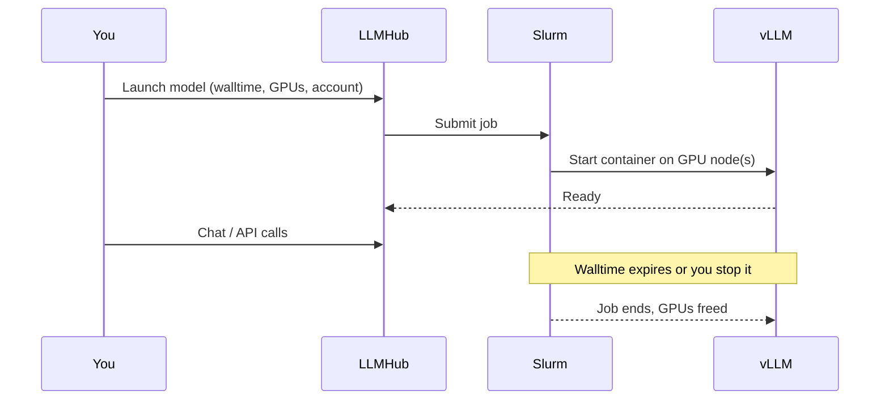

# Deploying models

This section covers the lifecycle of a model deployment: launching it,
understanding the GPU resources it uses, monitoring it, sharing it, and
getting new models added to the catalog.

## The deployment lifecycle

| Phase | What happens |
|---|---|
| Launch | LLMHub validates the request, resolves your Slurm account, and submits the job. |
| Download (first time) | Model weights are fetched into the cluster's shared cache. Cached models skip this. |
| Queue & start | Slurm schedules the job; the vLLM container starts on the GPU node(s). |
| Ready / running | The OpenAI-compatible endpoint is up; chat and API calls work. |
| Shutdown | You stop the deployment, or its walltime expires. GPUs are freed. |

Continue with [Launching a model](launching.md).
