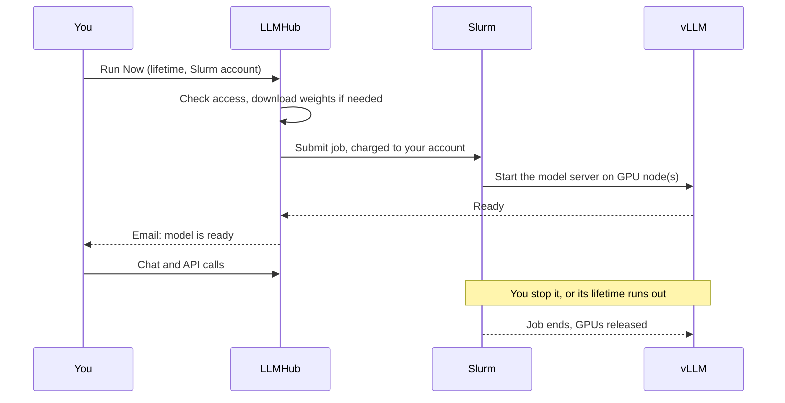

# Deploying models

A *deployment* is one copy of a model running on the cluster for you. This
section covers its whole life: launching it, what it costs, watching it,
sharing it, and asking for models the catalog doesn't have yet.

## The life of a deployment

| Stage | What happens | Status shown |
|---|---|---|
| Launch | LLMHub checks your Hugging Face access for gated models, and refuses the launch right away if something is wrong. | — |
| Download | The first launch of a model on the cluster downloads its weights. Models already on the cluster skip this. | **Downloading weights** |
| Queue | The Slurm job waits for free GPUs. | **Pending** |
| Start | The model server loads the weights onto the GPUs. Usually a few minutes. | **Launching** |
| Ready | Chat and the API work. You get an email, and the lifetime starts counting. | **Running** |
| End | You click **Stop**, or the lifetime runs out (you get an email), or the job fails (you get an email with the reason). The GPUs are released. | Card disappears |

## In this section

- [Launching a model](launching.md): the launch dialog, limits, and stopping
- [GPUs & cost](gpu-resources.md): how many GPUs a model uses, and what you're
  charged
- [Logs & monitoring](logs-monitoring.md): the Active Models page, logs and
  email notifications
- [Sharing & access](sharing-access.md): letting colleagues use your
  deployment
- [Requesting new models](requesting-models.md): getting a model added to
  the catalog
