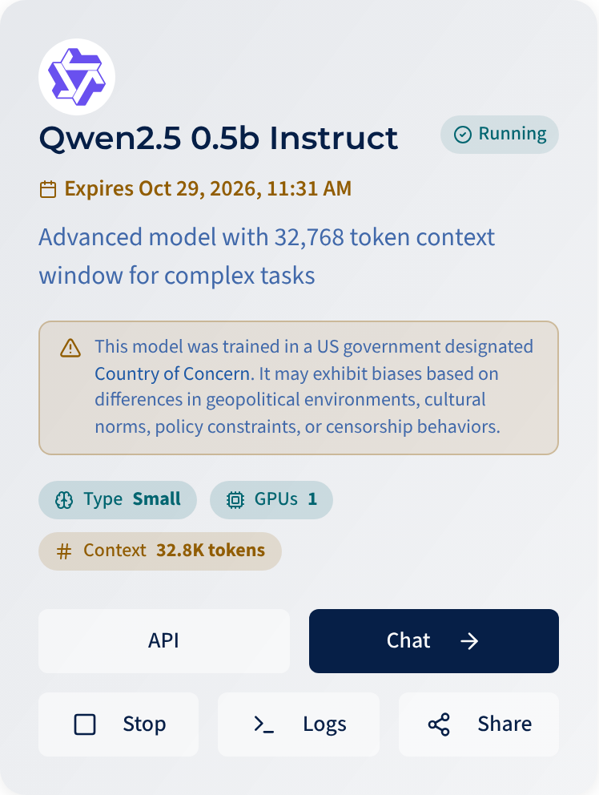
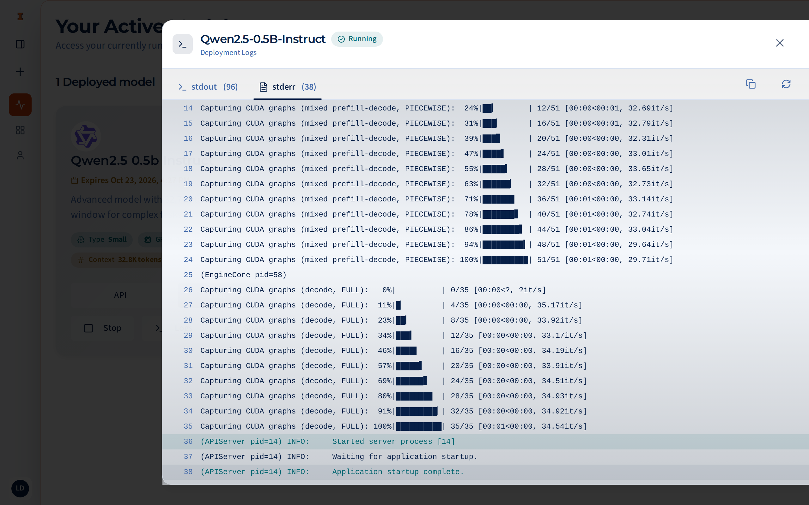

# Logs & monitoring

**Your Active Models**, in the sidebar, shows every deployment you can use
that's downloading, queued, starting or running: your own and any shared with
you. The page refreshes itself every 10 seconds.

## Deployment cards

Each card shows the model, its status, its chips, and, once it's running,
when it expires. The buttons:

| Button | What it does | Who sees it |
|---|---|---|
| **Chat** | Opens a chat with this deployment selected. Available once it's running. | Everyone with access |
| **API** | Opens the API dialog with a key, the base URL and code examples. Available once it's running. See the [API reference](../api/index.md). | Everyone with access |
| **Logs** | Opens the job's output in a side panel. | Everyone with access |
| **Share** | Gives other users access. See [Sharing & access](sharing-access.md). | The person who launched it |
| **Stop** | Shuts it down right away, with no confirmation. | The person who launched it |

<figure markdown="span">
  { width="320" loading=lazy }
  <figcaption>A running deployment card.</figcaption>
</figure>

## Reading the logs

The logs panel has two tabs, **stdout** and **stderr**, showing the last 200
lines of each and updating every couple of seconds. **Copy** puts the tab's
lines on your clipboard, which is handy for a bug report.

vLLM, the model server, writes most of its output, including errors, to
*stderr*. While a model starts you'll see it load the weights, measure GPU
memory, and size its cache. The model is ready soon after a line saying the
server has started.

<figure markdown="span">
  { loading=lazy }
  <figcaption>The logs panel on the <strong>stderr</strong> tab. "Application startup complete" means the model is ready.</figcaption>
</figure>

When something goes wrong, the cause is almost always in the last few lines.
The most common one is `CUDA out of memory`, or a KV cache that is *larger
than the available memory*: the model doesn't fit on the GPUs it was given.
Tell the administrators, since launch settings are set per model.

Problems with Hugging Face access never reach the logs. LLMHub checks your
token before submitting the job and refuses the launch right away.

## When a deployment ends

A deployment leaves **Your Active Models** as soon as it stops, for whatever
reason, and its logs are no longer available from the page:

- **You stopped it:** nothing else happens.
- **Its lifetime ran out:** LLMHub checks every few minutes and shuts it
  down. You get an email saying it has completed.
- **It failed:** you get an email with the reason. If you need the full logs,
  ask the administrators.

Your chats are kept in every case.

## Email notifications

LLMHub emails everyone with access to a deployment when it:

- is **ready** (the email says when it expires),
- has **failed** (with the reason),
- has **completed** because its lifetime ran out.

You also get an email when someone shares a deployment with you. Each email
is sent at most once per deployment.
