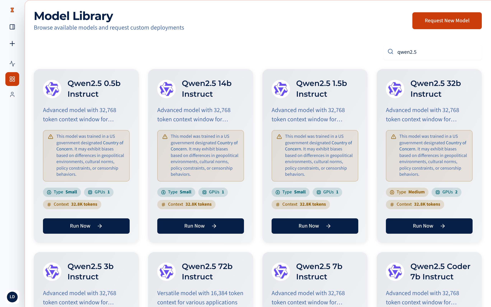
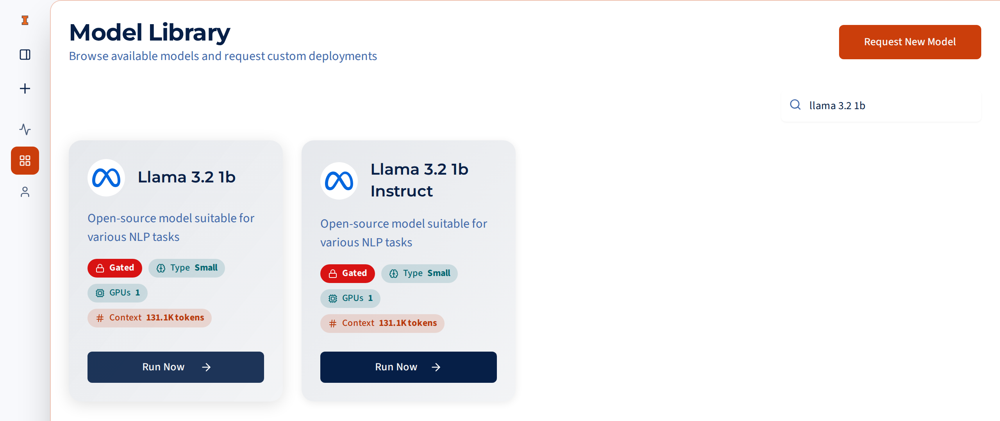
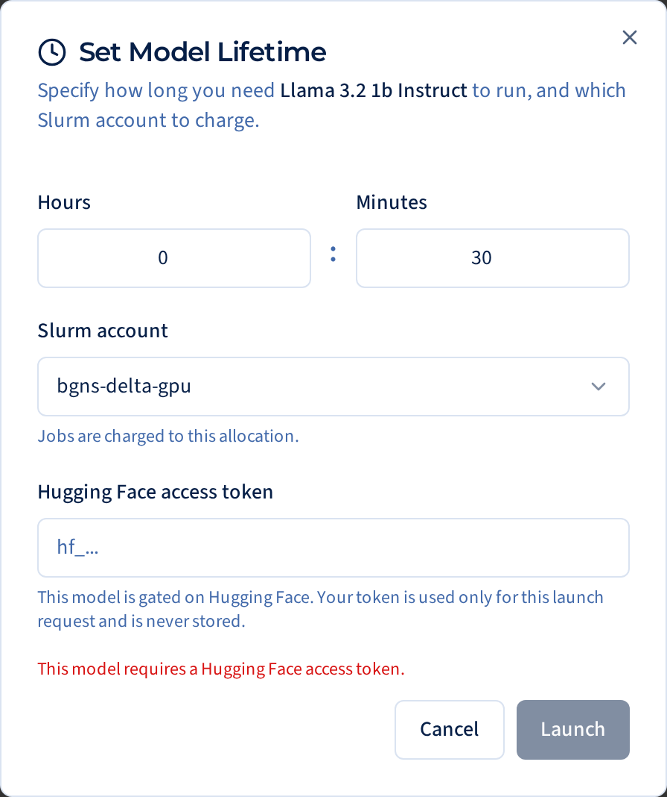

# Model library

The **Model Library** is the catalog of models you can launch. It's where you
land after signing in, and it's in the sidebar.

<figure markdown="span">
  { loading=lazy }
  <figcaption>The Model Library, searched for <code>qwen2.5</code>. Each Qwen card carries the <a href="#country-of-concern-notice">Country of Concern notice</a>.</figcaption>
</figure>

## Reading a model card

Each card shows the model's name, a short description of its family, and a
row of chips:

| Chip | Meaning |
|---|---|
| **Gated** (red, with a lock) | The model's publisher requires you to accept a license on Hugging Face before you can use it. See [Gated models](#gated-models). |
| **Small / Medium / Large** | How many GPUs the model needs: Small is 1, Medium is 2, Large is more. Bigger models take longer to start and use more of your allocation. |
| **GPUs** | The number of GPUs the launch uses. |
| **Context** | The longest input plus output the model accepts, for example *32K tokens*. |

Click **Run Now** to launch the model. See the
[Quickstart](quickstart.md#2-launch-a-model) for what the launch dialog asks.

### Country of Concern notice

Some cards carry a small caution notice: the model was trained by an
organization based in a country the US government designates a *Country of
Concern*, and it may reflect that country's geopolitical environment,
cultural norms, policies or censorship. In the current catalog that's the
**DeepSeek**, **Qwen** (including QwQ), **GLM** and **InternVL** models.
DeepSeek cards add a note about current federal guidance on DeepSeek and
warn that LLMHub may have to remove those models with little notice.

The notice is information, not a block: you can still launch these models.
Before using one for university work, read the University of Illinois
System's
[guidance on AI models from Countries of Concern](https://ai.uillinois.edu/userfiles/public/ui_system_ai_guidance_countries_of_concern.pdf).

!!! note "Where did a model go?"

    A model you already have running (or downloading, queued or starting)
    disappears from the library until you stop it. You can run only one copy
    of each model at a time; find it in **Your Active Models**.

## Searching

The search box matches words in a model's name, family, variant and
description, ignoring case. Model names are shown with spaces instead of
hyphens, so search for words rather than the exact repository name:

- `llama 3.2 1b` finds *Llama 3.2 1B Instruct*.
- `Llama-3.2-1B-Instruct` finds nothing.

<figure markdown="span">
  { loading=lazy }
  <figcaption>Searching for <code>llama 3.2 1b</code>. Both models carry the <strong>Gated</strong> chip.</figcaption>
</figure>

Models are listed by family, then by variant. There are no other sort or
filter options yet.

## Base and instruct models

Many models come in two forms:

- **Instruct** (or *Chat*, *-it*) models are tuned to follow instructions
  and hold a conversation. Use these for chat.
- **Base** models, without that suffix, only continue text. Some have no
  chat template at all, so chatting with them fails or gives odd output.
  Use them from the [API](../api/index.md) for completions-style work, or pick
  the instruct version.

## Gated models

Some publishers, Meta's Llama models for example, require you to accept
their license on Hugging Face before you can download the weights. These
models have a **Gated** chip, and the launch dialog asks for your Hugging Face
access token.

To launch one:

1. Sign in to [huggingface.co](https://huggingface.co), open the model's
   page, and accept its license. Some publishers review requests by hand, so
   approval can take a while.
2. Create an access token under **Settings → Access Tokens** on
   huggingface.co. A **Read** token is enough.
3. In LLMHub, click **Run Now** and paste the token (it starts with `hf_`)
   into the **Hugging Face access token** field.

<figure markdown="span">
  { width="448" loading=lazy }
  <figcaption>For a gated model, the launch dialog asks for your Hugging Face token.</figcaption>
</figure>

LLMHub uses the token only to check that you have access and to download
the weights. It isn't saved anywhere, isn't written into the cluster job, and
other users can't see it. You'll be asked for it again on every launch.

If the launch fails with a message about Hugging Face access, your token is
wrong or expired, or your license request hasn't been approved yet.

## Asking for a model that isn't listed

The catalog is curated: each model comes with launch settings tested on the
cluster. The **Request New Model** button isn't working yet. Until it is, see
[Requesting new models](../deploying/requesting-models.md).
