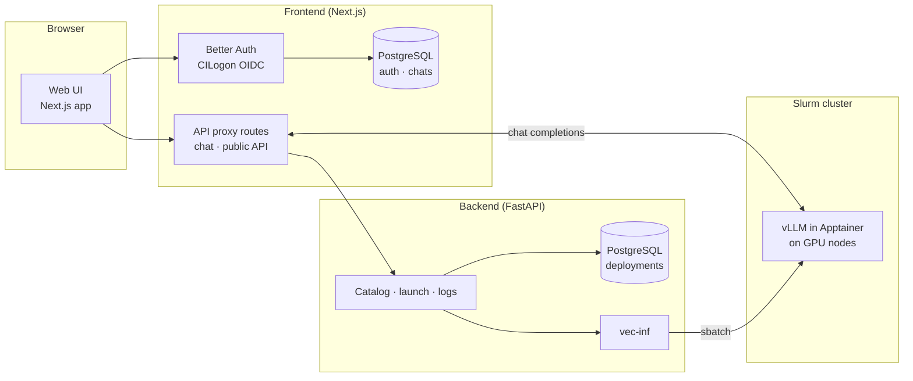

# Architecture



## Frontend (Next.js)

- **Auth**: Better Auth with CILogon OIDC. Sessions and users live in the
  frontend's PostgreSQL schema (Drizzle ORM). An optional oauth-mapfile
  gates which emails may sign in.
- **Chat**: the chat UI talks to Next.js route handlers, which proxy to the
  right deployment's vLLM endpoint (`/api/v1/deployment/{id}/...` for
  signed-in users, `/api/public/v1/deployment/{id}/...` for API-key
  callers). Access is checked server-side on every request.
- **Public API**: bearer-key authentication against personal API keys, then
  the same proxy path.
- **Always-on model**: a small model served outside the per-user deployment
  flow, used for guest mode and as a fallback.

## Backend (FastAPI)

- **Model catalog**: what can be launched, from the infrastructure's
  `models.yaml` (per-cluster), enriched with Hugging Face metadata
  (including gating status).
- **Launch orchestration**: validates the request (model, GPUs, account,
  HF gating), downloads weights when needed, then renders and submits the
  Slurm job through `vec-inf`. In impersonate mode the job runs as the
  signed-in user's cluster account, through a wrapper with ACL'd
  workspaces.
- **Lifecycle**: background sweeps watch for job completion and expiry;
  statuses flow back to the UI; notification emails go out on access
  grants and other events.

## The launch sequence

```text
1. UI        → backend:  POST launch (model, walltime, GPUs, account, hf_token?)
2. backend   → Hugging Face: gating check (token is user's, never stored)
3. backend   → cache:     download weights if missing (shared cache)
4. backend   → vec-inf:   render sbatch (vLLM + parallelism flags + env)
5. backend   → Slurm:     sbatch
6. Slurm     → GPU node:  apptainer run vllm.sif …
7. vLLM      → ready;     endpoint URL recorded on the deployment
8. UI        ← deployment status: ready — chat & API go live
```

Tensor/pipeline parallelism flags derive from the GPU/node request:
`gpus_per_node` → `--tensor-parallel-size`, `num_nodes` →
`--pipeline-parallel-size`.

## Databases

Two PostgreSQL schemas, by design: the frontend owns identity and chats;
the backend owns the catalog and deployment state. They are deployed
together but migrated independently (Drizzle for the frontend, the
backend's own migrations).

## Why the proxy pattern

The compute nodes are on a private network. Route handlers on the frontend
host are the single ingress: they terminate auth, enforce per-deployment
access, and stream responses. vLLM is never exposed directly.
