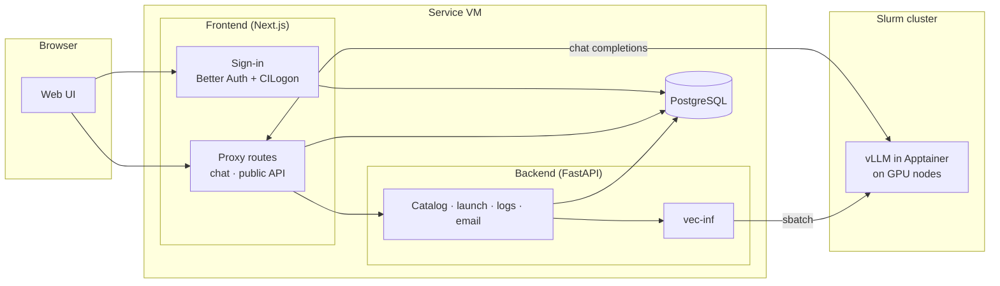

# Architecture



## Frontend (Next.js)

- **Sign-in**: Better Auth, with CILogon as the identity provider.
- **Chat**: the chat page sends messages to Next.js route handlers, which
  check that you can use the deployment and then forward the request to its
  vLLM server.
- **Public API**: the same forwarding, authenticated with a personal API key
  instead of a session. See the [API reference](../api/index.md).
- **Always-on model** (optional): a model served outside the launch flow, for
  sites that configure one. LLMHub on Delta doesn't.

## Backend (FastAPI)

- **Model catalog**: the models that can be launched, from `models.yaml` and
  any per-cluster overrides, plus each model's Hugging Face gating status.
- **Launches**: checks the request and the user's Hugging Face access,
  downloads weights the cluster doesn't have yet, and submits the Slurm job
  through vec-inf. The GPU count and other launch settings come from the
  catalog, not from the user.
- **Lifecycle**: background tasks follow each job's status, shut deployments
  down when their lifetime ends, and send the notification emails.

## What happens when you launch

```text
1. UI       → backend:   launch (model, lifetime, Slurm account, HF token if gated)
2. backend  → Hugging Face: check the user's access to a gated model (token never stored)
3. backend  → cluster:   download the weights if the cluster doesn't have them yet
4. backend  → vec-inf:   write the Slurm job script (vLLM command, GPUs, environment)
                         and give the job a key of its own that vLLM will require
5. vec-inf  → Slurm:     sbatch, charged to the chosen account
6. Slurm    → GPU node:  start vLLM in its Apptainer container
7. backend:              sees the server is up, records its address, emails "ready"
8. UI:                   status Running; Chat and API work
```

The number of GPUs and nodes in a model's catalog entry become vLLM's
tensor-parallel and pipeline-parallel sizes. See
[GPUs & cost](../deploying/gpu-resources.md).

## Database

There's one PostgreSQL database. The frontend's
[Drizzle](https://orm.drizzle.team) schema defines every table, including the
catalog and deployment tables the backend uses, and the frontend's migrations
are the only ones. The backend reads and writes those tables but never
changes their structure.

## Why everything goes through the frontend

Users never talk to the compute nodes or the vLLM servers directly. The
frontend's route handlers are the only way in: they check who you are and
whether you can use the deployment, then pass the request through and
stream the reply back. Model traffic doesn't go through the backend at all.

The vLLM servers enforce this themselves. Each deployment's server requires
its own key, which only the frontend knows, so a request that reaches a
compute node any other way is refused. Your LLMHub API key is never passed
on to vLLM.
